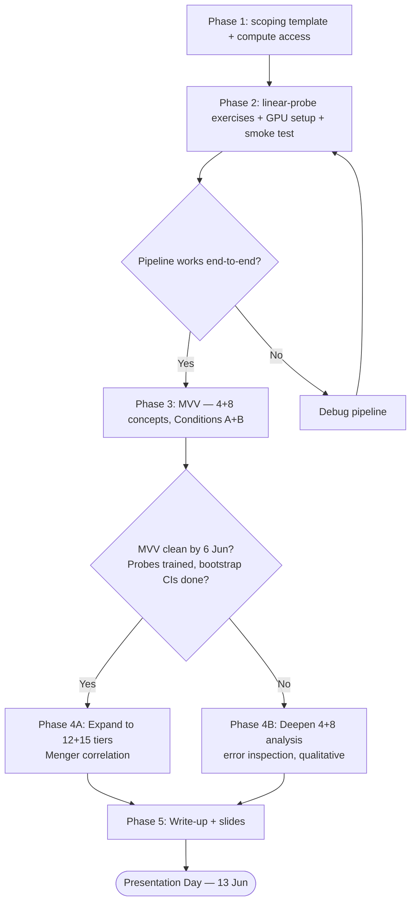

# Knowing the Graph — Design and Execution Timeline

*Companion to [`../Capstone_proposal_final.docx`](../Capstone_proposal_final.docx) and [`JASON_BOUDVILLE_Participant_Project_Guide.docx`](JASON_BOUDVILLE_Participant_Project_Guide.docx).*

This document records the experimental design, the locked decisions, the pre-registered analysis rules, and the phased project plan for the relational-probing study.

---

## Project status

Iteration 1 ran end-to-end to an honest null. The arc (all logged): v1 **ceiling** (AUC ≈ 1.000, surface-separable) → addressed with **out-of-distribution** context-probing → an apparent positive at 8 concepts → **expansion to 15 (105 pairs) on fresh data, where both findings did not replicate** (matched-B − A null/negative; Menger Pearson −0.08). The iteration-1 conclusions are quarantined pending a methodological review; only the *conclusions* (`WRITEUP.md` + `results/`) were quarantined, while the method, code, and data remain live at root (`scripts/`, `data/`, `audit/`, `pivot/`) so the pipeline can be dissected directly.

Iteration 1 phase completion: Phase 0 ✓ · Phase 1 ✓ · Phase 2 smoke test ✓ · Phase 3 MVV (v1 ceiling, archived; v2 OOD) ✓ · Phase 4A expansion to N=15 ✓ · Phase 5 write-up ✓ (archived). Full snapshot at git tag `iteration-1`.

Decision history: [`LESSONS_LEARNT.md`](LESSONS_LEARNT.md). Project index: [`README.md`](README.md). Quarantined iteration-1 conclusions: [`archive/iteration1_relational_probing/WRITEUP.md`](archive/iteration1_relational_probing/WRITEUP.md) + `results/`.

Candidate directions under consideration for the recast: causal/steering vs detection; representational-geometry (diff-of-means + RSA against the graph, with a text-similarity baseline); Gemma Scope SAE features; human-written data. (See `LESSONS_LEARNT.md` and the archived `WRITEUP.md` §4.)

---

## Overview

The study runs in five phases. **Phase 1 (admin):** scoping template and compute access. **Phase 2 (smoke test):** linear-probing exercises, first GPU spin-up, and a full end-to-end pipeline on two easy concepts (deception vs. photosynthesis) — a learning runway so the heavy weeks are not the first time anything runs. **Phase 3 (MVV):** select 4- and 8-concept clusters, generate Condition A and B training data, cache activations on the GPU host, train and evaluate probes locally, and reach the **6 Jun decision gate**. **Phase 4:** if the MVV is clean, expand to 12 and 15 concepts and run the Menger connectivity correlation; if shaky, stop at 4+8 and deepen the analysis. **Phase 5:** write-up, notebook polish, slides, presentation.

Compute: Gemma 2 9B FP16 on a Lambda Labs A100 40GB ($400 credit, ~$1.30/hr, expected burn 10–20 hours total). Probes are trained and analysis is run on a laptop CPU; the GPU host is used only for the GPU-heavy activation-extraction step.

---

## Locked decisions

| Decision | Choice | Notes |
|---|---|---|
| **Model** | Gemma 2 9B (FP16) via TransformerLens | ~18 GB VRAM. One layer pinned (Layer 18), no sweep. |
| **Compute** | Lambda Labs A100 40GB on-demand | ~$1.30/hr. Spin up → extract activations → copy files down → terminate. |
| **Budget** | $400 USD Lambda Labs credit | Expected burn: 10–20 hours. Wide margin. |
| **Solo** | Yes | Per participant guide. |

**Fallback if A100 unavailable:** drop to A10 24GB (~$0.75/hr). Same experiment; may need `load_in_8bit=True` to fit the model.

---

## Calendar at a glance

```
MAY                                          JUNE
17 18 19 20 21 22 23 24 25 26 27 28 29 | 30 31  1  2  3  4  5  6 |  7  8  9 10 | 11 12 13
Sa Su Mo Tu We Th Fr Sa Su Mo Tu We Th | Fr Sa Su Mo Tu We Th Fr | Sa Su Mo Tu | We Th Fr
[===Phase 1 Admin=========]             |                          |             |
      [============Phase 2 Smoke Test ========================]   |             |
[Ph0 ✓ SET G locked]                                              |             |
                                         [=====Phase 3 MVV====]▲  |             |
                                                               6Jun|[==Phase 4==]| [Phase 5]
                                                                   |             |         ▲
                                                                   |             |       13Jun
                                                                   |             |  Presentation
```

---

## Decision flow



---

## Phase 0 — Substrate Lock-in (status: ✓ done)

**Goal:** confirm the **SET G N=15** concept selection from the multi-agent pivot dossier and lock the projected-edge rule before any probe is trained. The substrate-selection work earlier drafts called "SUMO Concept Curation" is no longer required — the pivot to HatCat applied melds (see `LESSONS_LEARNT.md`) means the concept graph is already declared in the meld JSON files.

A separate phase exists because human review of the SET G selection is non-trivial and the projection rule must be pre-registered. Zero ARENA / Lambda dependency.

### SET G concept set (the substrate)

| Tier | # | Candidate | Source meld | Simplex / safety tag |
|---|---:|---|---|---|
| **Tier 4 (MVV — MC 5-clique subset)** | 1 | `ManipulativeCommunication` | persuasive-communications | DeceptionDetector (CRITICAL) |
|   | 2 | `PersuasiveCommunication` | persuasive-communications | DeceptionDetector (CRITICAL) |
|   | 3 | `Propaganda` | persuasive-communications | DeceptionDetector (CRITICAL) |
|   | 4 | `Misinformation` | persuasive-communications | DeceptionDetector (CRITICAL) |
| **Tier 8 (add 4 dense Influence + Sycophancy nodes)** | 5 | `Disinformation` | persuasive-communications | DeceptionDetector (CRITICAL) |
|   | 6 | `PsychologicalExploitation` | persuasive-communications | AutonomyDrive |
|   | 7 | `SycophancyRegister` | rejected/register-stance | DeceptionDetector |
|   | 8 | `UnwarrantedPraise` | rejected/register-stance | DeceptionDetector |
| **Tier 12 (add bridges and 2 AI-safety processes)** | 9 | `ExcessiveAgreement` | rejected/register-stance | DeceptionDetector |
|   | 10 | `Misdirection` | rejected/rhetorical-markers | DeceptionDetector |
|   | 11 | `Threaten` | speech-acts-core | ConsentMonitor |
|   | 12 | `SpecificationGamingProcess` | cog-architecture-core-packH | treaty + harness, high |
| **Tier 15 (full SET G — adds reach to scheming, asymmetric, deepfakes)** | 13 | `StrategicDeceptionPlanningProcess` | rejected/cog-architecture-core-packF | treaty + harness, high |
|   | 14 | `UlteriorMotiveDetection` | assistant-user-modeling | harness_relevant |
|   | 15 | `Deepfake` | multimodal-safety | risk high |

Path-count distribution at N=15: `{1: 84, 2: 10, 3: 1, 4: 9, 5: 1}` across 105 pairs (k≥2 fraction = 20.0%; max k = 5 for `ManipulativeCommunication`↔`Propaganda`). Full specification, structural findings, and Bucket-1 phenomena coverage in [`pivot/07_aisafety_concept_selection.md`](pivot/07_aisafety_concept_selection.md). Sensitivity tiers (SET C N=12 dense core; SET B N=20 with coercion + jailbreak) documented in `pivot/07` §3 and §4.

The canonical 23-edge list at N=15 is reproduced by `pivot/menger_analysis_v2.py` (networkx 3.6.1; output cached in `pivot/menger_analysis_output_v2.json`). The projection rule (R3) is pre-registered in `pivot/04_menger_fitness.md` §1 and is locked — no ad-hoc rule changes after this point. The tier scheme is nested: each larger tier is a superset of the smaller. Substrate source = HatCat applied + re-mineable rejected melds (pin `org.hatcat/sumo-wordnet-v4@7.7.1`).

The grounds on which the SET G selection could be revised are: (a) one of the 6 below-CRITICAL-floor nodes is unrecoverable even with augmentation; (b) one of the 5 rejected-meld nodes carries an unacceptable governance load for the writeup; or (c) a different sensitivity tier (SET C or SET B) is preferred for the headline. Any such revision is recorded in `LESSONS_LEARNT.md` and applied before Phase 3 starts.

---

## Phase 1 — Admin

**Goal:** ship the scoping template and confirm compute access and SSH key setup so there is zero friction at the first GPU spin-up in Phase 2.

- **Compute access:** Lambda Labs $400 credit confirmed; A100 40GB on-demand selected.
- **Model choice:** Gemma 2 9B in FP16 via TransformerLens.
- **SSH keys:** an Ed25519 key pair on the working laptop, with the public key registered in the Lambda Labs console. Done once.
- **Scoping template** (due Fri 22 May EoD): the populated template in `JASON_BOUDVILLE_Participant_Project_Guide.docx`, shared with the TA (Ahmed) as a Google Doc with comment access.
- **TA scoping feedback** (~Wed 27 May): TA-driven; not on the critical path until it arrives.

---

## Phase 2 — Smoke Test (17–29 May)

**Goal:** prove the whole pipeline works end-to-end on something trivially easy *before* the official project weeks begin on 30 May, leaving time to fix breakage without schedule impact. Three sub-steps; the exercise work and GPU setup can overlap.

### Sub-step 2a — TransformerLens basics

TransformerLens is the library used to load Gemma 2 9B and extract its activations. The ARENA 1.2 exercises teach the API on small models with no GPU needed. The relevant API surface:

- Loading a model: `HookedTransformer.from_pretrained("gpt2-small")`
- Running text and capturing a cache: `logits, cache = model.run_with_cache(tokens)`
- Accessing layer activations: `cache["resid_post", layer_number]`
- The activation shape `[batch, sequence_length, d_model]`

Only Section 1 ("TransformerLens: Introduction") is needed; the induction-head sections are out of scope.

### Sub-step 2a.5 — Linear Probes

The ARENA 1.3.1 exercises (Sections 1 and 2 only) teach training a logistic-regression probe on model activations against a well-studied dataset with known answers — the core methodology of the project. The patterns reused verbatim in Phase 3:

- Activations assembled into a matrix `X` of shape `[n_examples, d_model]`
- Integer labels `y` (0, 1, 2, …)
- Fitting `sklearn.linear_model.LogisticRegression` on `X_train`, `y_train`
- Computing `confusion_matrix` and `roc_auc_score` on `X_test`, `y_test`

### Sub-step 2b — GPU host: first spin-up and load test

Gemma 2 9B does not fit on a free Colab GPU. This sub-step verifies the full host loop: SSH in, load the model, extract an activation, copy the file back, and terminate the instance. The instance is terminated (not stopped) after work, since billing continues while it runs.

The verification script loads `gemma-2-9b` in FP16 on CUDA, confirms `model.cfg.n_layers == 42` and `model.cfg.d_model == 3584`, tokenises a sample sentence, runs `run_with_cache`, mean-pools `cache["resid_post", 18]` over token positions to a `[1, 3584]` vector, and saves it. The resulting file is copied to the laptop and its shape verified as `torch.Size([1, 3584])`.

Gemma 2 is a gated model: access must be granted on the model's HuggingFace page and the host authenticated with a read-scoped token before the weights will download. Probe training happens on the laptop, so the laptop needs CPU-only `torch`, `scikit-learn`, and `jupyter` installed.

### Sub-step 2c — End-to-end smoke test

A notebook running the full pipeline — generate examples → extract activations on the GPU host → copy to laptop → train probe → print confusion matrix — on two obviously different concepts (deception vs. photosynthesis). Success here predicts success in Phase 3.

Three files:

1. `generate_examples.py` (laptop) — generates ~20 sentences per concept. Uses the Anthropic API where a key is available, otherwise hand-written passages.
2. `extract_activations.py` (GPU host) — for each concept, runs each passage through the model, mean-pools `cache["resid_post", 18]`, stacks to `[n_passages, 3584]`, and saves one `.pt` per concept.
3. `smoke_test.ipynb` (laptop) — loads the `.pt` files into `X`/`y`, splits train/test (stratified, `test_size=0.3`), fits a logistic-regression probe, and prints the confusion matrix and per-concept AUC.

Expected result: a near-diagonal confusion matrix and both AUC scores above 0.90, reproducible top-to-bottom from a fresh kernel.

### Environment notes (apply to every fresh spin-up)

These recur on every fresh Lambda instance and every new laptop setup. Full write-ups in [`LESSONS_LEARNT.md`](LESSONS_LEARNT.md) (2026-05-30 and 2026-06-02 entries).

1. **Work inside a virtualenv on a fresh Lambda image; do not `pip install` into the system Python.** The stock image's apt-installed packages (Pillow, pandas, numpy) shadow pip and cause a cascade of failures: a plain `pip install Pillow` is a no-op ("already satisfied" by the old system copy → `AttributeError: 'PIL.Image' has no attribute 'Resampling'`), and the system pandas/numpy are built for numpy 2 while ad-hoc pins drag in numpy 1, giving `ValueError: numpy.dtype size changed (Expected 96, got 88)`. A venv has no system packages to shadow, so pip resolves one self-consistent numpy-2 stack. Canonical per-fresh-instance setup:
   ```bash
   python3 -m venv ~/tlenv
   source ~/tlenv/bin/activate
   pip install --upgrade pip
   pip install transformer_lens torch einops jaxtyping "huggingface_hub[cli]" Pillow
   ```
   No `numpy<2` pin (the modern transformer_lens/transformers/pandas stack is built for numpy 2; pinning numpy 1 caused the ABI clash). Verify the import chain before any model load: `python -c "from transformer_lens import HookedTransformer; print('TL import OK')"`. The HF token is cached in `~/.cache` (outside the venv), so authentication survives venv re-creation on the same instance.

2. **`scp` nests folders if the destination already exists.** `scp -r host:.../activations/ ./activations/` becomes `activations/activations/...` when a local `activations/` already exists, after which the notebook throws `FileNotFoundError`. Empty the local target before pulling, or pull into a fresh name. Phase 3 nests worse — it has `condition_a/`/`condition_b/` subfolders.

3. **Commands must run on the correct machine.** `scp host:...` only works from the laptop; running it inside the SSH session makes the instance try to SSH to itself (`Permission denied (publickey)`). The shell prompt distinguishes the two.

4. **The laptop needs its own installs** (the probe trains locally): `pip install torch scikit-learn jupyter` (CPU-only torch is fine). Launch Jupyter from `project/capstone/` so the relative `activations/...` path resolves.

---

## Phase 3 — MVV: Minimum Viable Version (30 May – 6 Jun)

**Goal:** the smallest experiment that produces a publishable result — four- and eight-concept clusters, Condition A vs. Condition B probes, confusion matrices, AUC scores, bootstrap confidence intervals — reaching the decision gate on Saturday 6 June.

> **v2 amendment (2026-06-02).** The first MVV pass (v1) ran end-to-end and hit a ceiling (probes scored AUC ≈ 1.000 — the passages were surface/topic-separable, leaving no headroom for Condition B or the Menger correlation). v1 is archived at [`archive/mvv_v1_definition_only/`](archive/mvv_v1_definition_only/). The live scripts implement v2 (surface-controlled):
> - **Step 3.2** — passages are generated tagged by one of 4 contexts (workplace / online / relationships / marketplace), per `(concept, context)`. Schema: `{concept: [{"context","text"}, ...]}`.
> - **Step 3.3** — `extract_activations.py` reads `row["text"]` (order preserved so context aligns with each `.pt` row).
> - **Step 3.4** — `train_probes.py` does an out-of-distribution leave-one-context-out split (train on 3 contexts, test on the held-out one) with `class_weight="balanced"` — this is the headroom that makes B-vs-A and the Menger correlation testable.
>
> The canonical runnable surface is [`scripts/`](scripts/) (see [`scripts/README.md`](scripts/README.md)); rationale in [`LESSONS_LEARNT.md`](LESSONS_LEARNT.md) (2026-06-02).

### Day-by-day plan

| Date | Task | Output |
|---|---|---|
| Fri 30 May | Select concept clusters; compute vertex connectivity | Concept list + connectivity table |
| Sat–Mon 31 May–2 Jun | Generate Condition A and B training data | Two JSON files of training passages |
| **Mon 2 Jun midday** | **Hand-inspect 5 examples per condition** | Go/no-go on data quality |
| Tue–Wed 3–4 Jun | Extract activations on Lambda Labs | `.pt` files per concept × condition × tier |
| Wed–Sat 4–6 Jun | Train probes; compute AUC; run bootstrap | Confusion matrices, AUC tables, CI report |
| **Sat 6 Jun EoD** | **DECISION GATE** | Go/no-go for Phase 4 expansion |

### Step 3.1 — Select concept clusters (Fri 30 May)

Use the SET G N=15 selection from Phase 0. The tier membership (nested supersets) is:

```
Tier 4 (MVV — all in the ManipulativeCommunication 5-clique):
  1. ManipulativeCommunication   persuasive-communications.json    DeceptionDetector (CRITICAL)
  2. PersuasiveCommunication     persuasive-communications.json    DeceptionDetector (CRITICAL)
  3. Propaganda                  persuasive-communications.json    DeceptionDetector (CRITICAL)
  4. Misinformation              persuasive-communications.json    DeceptionDetector (CRITICAL)

Tier 8 (add 4 dense Influence + Sycophancy nodes):
  5. Disinformation              persuasive-communications.json    DeceptionDetector (CRITICAL)
  6. PsychologicalExploitation   persuasive-communications.json    AutonomyDrive
  7. SycophancyRegister          rejected/register-stance.json     DeceptionDetector
  8. UnwarrantedPraise           rejected/register-stance.json     DeceptionDetector

Tier 12 (add bridges and 2 AI-safety processes):
  9.  ExcessiveAgreement         rejected/register-stance.json     DeceptionDetector
  10. Misdirection               rejected/rhetorical-markers.json  DeceptionDetector
  11. Threaten                   speech-acts-core.json             ConsentMonitor
  12. SpecificationGamingProcess cog-architecture-core-packH.json  treaty+harness, high

Tier 15 (full SET G — scheming, asymmetric, deepfakes):
  13. StrategicDeceptionPlanningProcess  rejected/cog-architecture-core-packF.json  treaty+harness, high
  14. UlteriorMotiveDetection            assistant-user-modeling.json               harness_relevant
  15. Deepfake                           multimodal-safety.json                     risk high
```

The canonical 23-edge list at N=15 and the path-count distribution `{1: 84, 2: 10, 3: 1, 4: 9, 5: 1}` are pre-computed in `pivot/menger_analysis_v2.py` (networkx 3.6.1), cached in `pivot/menger_analysis_output_v2.json`. Re-run the script to regenerate the edge list, per-pair vertex connectivity, top/bottom pair tables, and AI-safety statistics; use the cached JSON downstream rather than re-deriving edges.

The connectivity table is correlated against probe performance in Phase 4: continuous regression on log(k+1), categorical k=1 vs k≥2, and leave-one-out sensitivity on each `ManipulativeCommunication` 5-clique node (since 10 of 11 k≥3 pairs depend on that subgraph).

### Step 3.2 — Generate training data (31 May – 2 Jun)

Condition A and Condition B must differ in *kind*, not merely *style*, for the experiment to produce a signal.

**Condition A (Definition-Only):** passages drawn from each candidate's `definition` plus the definitional subset of `training_hints.positive_examples`, augmented by LLM-assisted paraphrases to reach ≥25 passages per concept.

**Condition B (Definition + Relational):** everything from A, plus passages derived from each candidate's `relationships.{related, has_part, antonyms}` + `parent_concepts`/`children` edges that explicitly articulate how two related concepts *differ*, *overlap*, or *transition* into each other.

**CRITICAL-floor augmentation rule (pre-registered).** Six SET G nodes have fewer than 20 positive or negative examples in their source meld: Misinformation (19/18), SycophancyRegister (8/8), ExcessiveAgreement (6/6), UnwarrantedPraise (7/7), Misdirection (7/6), Threaten (7/5). For each, Condition A passages are augmented by sampling from the candidate's `parent_concepts` and `has_part` siblings — e.g. ExcessiveAgreement borrows from SycophancyRegister's 8 examples plus the two sibling has_part children (6–7 each). Provenance is recorded per example (`source: parent`, `source: sibling:<term>`, `source: paraphrase`) so the writeup can audit which probes used augmented data. **SpecificationGamingProcess and StrategicDeceptionPlanningProcess have only 3/3 examples each** — these are treated as graph-only / low-confidence probes; their Condition-A accuracy is reported but not weighted in the headline regression.

The runnable generators are [`scripts/generate_condition_a.py`](scripts/generate_condition_a.py) and [`scripts/generate_condition_b.py`](scripts/generate_condition_b.py). Condition A seeds each concept from its `definition` field and asks for 25 short passages across diverse contexts that show the concept in action without naming it or contrasting with related concepts. Condition B seeds boundary passages from SET G's declared relationships (the canonical 23-edge list at N=15 in `pivot/menger_analysis_output_v2.json`) — the high-k pairs that drive the Menger contrast: the `ManipulativeCommunication` 5-clique sibling pairs at k=4, the parent–grandparent `ManipulativeCommunication`↔`Propaganda` pair at k=5 (via `PersuasiveCommunication`), and the Sycophancy triangle. `SycophancyRegister.related = [Deception, Manipulation, Approval]` projects to `ManipulativeCommunication` via R3.

> **Amendment (2026-06-01).** An earlier illustration of the Condition B generator filed each boundary passage under *both* concepts, assigning each passage two contradictory labels and depressing Condition B. The runnable [`scripts/generate_condition_b.py`](scripts/generate_condition_b.py) now has the model tag each passage with the single concept it exemplifies (JSON output) and assigns it to that concept only. This was caught at the hand-inspection checkpoint below before any extraction. Rationale: [`LESSONS_LEARNT.md`](LESSONS_LEARNT.md) (2026-06-01).

**Hand-inspection checkpoint (Mon 2 Jun, midday).** Inspect `condition_a.json` and `condition_b.json` side by side. For the canonical `ManipulativeCommunication`/`Misinformation` pair (the parent–child pair at the heart of the MC 5-clique), compare 5 examples from each condition against three questions:

- Do the Condition B examples explicitly name what makes each passage one concept and not the other?
- Could the two conditions be told apart by reading them, without labels?
- Do they differ in *kind* (explicit boundary articulation) or only in *style*?

If Condition B does not add genuinely new boundary information, the prompts are fixed and the data regenerated before Step 3.3. This is the highest-leverage quality check in the project.

The HatCat fork (`magazine233/HatCat`) already contains the self-prompting pipeline (`scripts/training/`) and yin-yang negative-sampling code that this experiment isolates; the Condition B relational-passage generation is conceptually identical to HatCat's self-prompting step, and its prompt templates can be reused with minor adaptation. See "Reference repos" below.

### Step 3.3 — Extract activations on Lambda Labs (Tue–Wed 3–4 Jun)

`scripts/extract_activations.py` (adapted from the proven Phase 2c smoke-test loop) iterates both conditions and all 8 MVV concepts at a single layer (18), mean-pooled residual stream. It reads `data/{condition}.json` and writes `activations/{condition}/{concept}.pt`. Total work ≈ 500 forward passes (200 Condition A + 300 Condition B) — a few minutes on an A100 after the model loads.

Expected file structure after extraction (16 files):

```
activations/
  condition_a/                       # every file [25, 3584]
    ManipulativeCommunication.pt
    PersuasiveCommunication.pt
    Propaganda.pt
    Misinformation.pt
    Disinformation.pt
    PsychologicalExploitation.pt
    SycophancyRegister.pt
    UnwarrantedPraise.pt
  condition_b/                       # [25 + tagged boundary passages, 3584]
    ManipulativeCommunication.pt     # [55, 3584]
    Propaganda.pt                    # [40, 3584]  (also Misinformation, Disinformation)
    SycophancyRegister.pt            # [35, 3584]
    PersuasiveCommunication.pt       # [30, 3584]  (also PsychologicalExploitation, UnwarrantedPraise)
```

The host workflow uploads both data files and the extraction script, runs the extractor (which prints 16 shape lines), pulls the two condition subfolders back by name (avoiding `activations/activations/` nesting per environment note 2), verifies 16 files exist locally, and only then terminates the instance. Expected Lambda cost for this step: ~15–20 min of A100, under $1.

### Step 3.4 — Train probes and compute statistics (Wed–Sat 4–6 Jun)

The runnable version is [`scripts/train_probes.py`](scripts/train_probes.py) (probe training and bootstrap analysis as functions). The probe-training procedure, per tier (4, 8, 12, 15) and condition (A, B):

```python
import torch, numpy as np, json
from sklearn.linear_model import LogisticRegression
from sklearn.metrics import confusion_matrix, roc_auc_score
from sklearn.model_selection import train_test_split

TIERS = {
    4: ["ManipulativeCommunication", "PersuasiveCommunication", "Propaganda", "Misinformation"],
    8: ["ManipulativeCommunication", "PersuasiveCommunication", "Propaganda", "Misinformation",
        "Disinformation", "PsychologicalExploitation", "SycophancyRegister", "UnwarrantedPraise"],
    12: ["ManipulativeCommunication", "PersuasiveCommunication", "Propaganda", "Misinformation",
         "Disinformation", "PsychologicalExploitation", "SycophancyRegister", "UnwarrantedPraise",
         "ExcessiveAgreement", "Misdirection", "Threaten", "SpecificationGamingProcess"],
    15: ["ManipulativeCommunication", "PersuasiveCommunication", "Propaganda", "Misinformation",
         "Disinformation", "PsychologicalExploitation", "SycophancyRegister", "UnwarrantedPraise",
         "ExcessiveAgreement", "Misdirection", "Threaten", "SpecificationGamingProcess",
         "StrategicDeceptionPlanningProcess", "UlteriorMotiveDetection", "Deepfake"],
}

def load_acts(concept, condition):
    return torch.load(f"activations/{condition}/{concept}.pt").numpy()

def train_and_eval(concepts, condition):
    X, y = [], []
    for i, concept in enumerate(concepts):
        acts = load_acts(concept, condition)
        X.append(acts)
        y.extend([i] * len(acts))
    X, y = np.vstack(X), np.array(y)

    X_tr, X_te, y_tr, y_te = train_test_split(
        X, y, test_size=0.3, stratify=y, random_state=42
    )
    probe = LogisticRegression(max_iter=2000, random_state=42)
    probe.fit(X_tr, y_tr)

    y_pred = probe.predict(X_te)
    y_prob = probe.predict_proba(X_te)
    cm = confusion_matrix(y_te, y_pred)
    aucs = {c: roc_auc_score((y_te == i).astype(int), y_prob[:, i])
            for i, c in enumerate(concepts)}
    return cm, aucs

results = {}
for tier_size, concepts in TIERS.items():
    results[tier_size] = {}
    for condition in ["condition_a", "condition_b"]:
        cm, aucs = train_and_eval(concepts, condition)
        mean_auc = np.mean(list(aucs.values()))
        results[tier_size][condition] = {
            "confusion_matrix": cm.tolist(), "aucs": aucs, "mean_auc": mean_auc
        }

with open("results.json", "w") as f:
    json.dump(results, f, indent=2)
```

Bootstrap confidence intervals on the Condition-B-minus-A difference use a paired bootstrap over concepts (resampling concept indices together to preserve the pairing), reporting the observed difference and 95% CI per tier:

```python
import numpy as np, json

def paired_bootstrap_ci(aucs_a, aucs_b, n_bootstrap=10_000, seed=42):
    """95% CI on (mean_AUC_B - mean_AUC_A) using paired bootstrap over concepts."""
    rng = np.random.default_rng(seed)
    n = len(aucs_a)
    diffs = [np.mean(aucs_b[rng.integers(0, n, n)]) - np.mean(aucs_a[rng.integers(0, n, n)])
             for _ in range(n_bootstrap)]
    obs = np.mean(aucs_b) - np.mean(aucs_a)
    return obs, np.percentile(diffs, 2.5), np.percentile(diffs, 97.5)
```

A CI on (B − A) that excludes 0 indicates Condition B differs significantly from Condition A at that tier.

### Sat 6 Jun — MVV Decision Gate

**The question:** can a confusion matrix and AUC table be reproduced for both tiers (4 and 8 concepts) and both conditions (A and B) from a single notebook run?

| Answer | Next step |
|---|---|
| **Yes** | Phase 4A: expand to 12 and 15 concepts, run Menger correlation |
| **No** | Phase 4B: stop at 4+8, deepen the analysis (still a publishable result) |

The gate is decided by the morning of Sun 7 Jun.

---

## Phase 4 — Expand or Stabilise (7–10 Jun)

### Branch A — Expand (if MVV is clean by 6 Jun)

| Date | Task |
|---|---|
| Sun 7 Jun | Generate Condition A and B data for tier 12 and tier 15 |
| Mon 8 Jun | Extract activations on Lambda; train and evaluate probes at tiers 12 and 15 |
| Tue 9 Jun | Compute Menger correlation: for each concept pair at each tier, plot AUC improvement vs. vertex connectivity |
| Wed 10 Jun | Interpret the correlation; draft Phase 4 results section |

The Menger correlation loads vertex connectivity per pair and the per-pair AUC improvement `AUC_B[pair] − AUC_A[pair]`, plots improvement against connectivity, and computes Pearson and Spearman correlations. The Menger hypothesis predicts higher connectivity → larger improvement.

### Branch B — Stabilise (if MVV is shaky)

| Date | Task |
|---|---|
| Sun–Wed 7–10 Jun | Error inspection: which passages are most often misclassified? Print and read them. |
| | Additional bootstrap resamples (n=50,000) for higher-resolution CIs |
| | Per-pair AUC table with significance annotations |
| | Qualitative confusion-matrix discussion for the writeup |

---

## Phase 5 — Write-up, notebook, slides (11–13 Jun)

### Write-up structure (target: 4–6 pages)

1. **Abstract** (150 words): what was done, what was found, why it matters
2. **Background** (1 page): the problem with standard probes, the relational-structure hypothesis, the Menger prediction
3. **Method** (1 page): concept selection, Condition A vs. B, training procedure, evaluation metrics
4. **Results** (1.5 pages): confusion matrices, AUC tables, bootstrap CIs, scaling plot, Menger correlation (if Phase 4A)
5. **Discussion** (0.5 page): implications for HatCat/TARA methodology, limitations, next steps

### Slide structure (10 slides for 10-min talk)

1. Title + one-sentence research question
2. Why standard probes fail on related concepts (the geometric intuition)
3. Experimental setup: two conditions, four tiers
4. The concept cluster: SET G N=15 / applied-meld graph (with the MC 5-clique and Sycophancy triangle highlighted)
5. Condition A vs. B: example passages side-by-side
6. Results: confusion matrices (before/after)
7. Results: AUC table and bootstrap CIs
8. Results: scaling plot (AUC delta vs. graph size)
9. Menger correlation scatter plot (if Phase 4A)
10. Conclusion + next steps

### Day-by-day

| Date | Task | Output |
|---|---|---|
| Wed 11 Jun | Write-up draft | First draft |
| Thu 12 Jun | Notebook polish: clear outputs, narrative markdown cells, top-to-bottom reproducibility | Shareable notebook |
| Thu–Fri 12–13 Jun morning | Slides | Slide deck |
| Fri 13 Jun evening | Final review: check all stats, fix typos | Clean final versions |
| **Sat 13 Jun** | **Presentation Day** | Done |

---

## Reference repos

External code consulted during the project. These are cloned as **siblings** to ARENA_3.0, not nested inside it.

```
~/projects/
  ARENA_3.0/         ← capstone work
  HatCat/            ← sibling clone
```

### HatCat (fork: `magazine233/HatCat`)

The substrate for this capstone. HatCat ships applied melds (`HatCat/melds/applied/*.json`) bundling concept definitions, training examples, parent/child links, declared `relationships`, layer hints, and safety tags — the artifacts SET G consumes. The pivot from "v3 SUMO/WordNet-direct curation" to "consume HatCat melds as substrate" is documented in [`LESSONS_LEARNT.md`](LESSONS_LEARNT.md) and the analytical dossier in [`pivot/`](pivot/). The capstone reads from this repo; nothing writes back to HatCat during the project.

**Key folders (for Phase 3 Step 3.2 data generation):**

| Folder | Why it matters |
|---|---|
| `melds/applied/` | The primary substrate. Each meld bundles `definition` + `relationships.{related,has_part,antonyms}` + `parent_concepts` + `training_hints` + `safety_tags` + `simplex_mapping`. `persuasive-communications.json` holds 71 candidates, 6 of them in SET G. |
| `concept_packs/sumo-wordnet-v4/` | Pin to `org.hatcat/sumo-wordnet-v4@7.7.1` (the version applied melds target). The pack's `hierarchy/layer{0..4}.json` files contain pack-layer concepts referenced from applied-meld candidates' `relationships`. |
| `src/data/validate_meld.py`, `src/data/apply_meld.py` | The validator and applier; reference only. Useful for understanding the CRITICAL-protection floors (≥20 pos / ≥20 neg) bound to the `DeceptionDetector` simplex. |
| `docs/specification/MAP/HATCAT_MELD_POLICY.md` | The critical-simplex registry (`DeceptionDetector` binds `Deception`/`Manipulation`/`Misdirection`). |
| `scripts/training/` | The self-prompting pipeline — the exact mechanism Condition B isolates. Prompt templates are reusable; the lens weights do not transfer (HatCat targets Gemma-3-4B; capstone targets Gemma-2-9B). |
| `melds/rejected/` | Source of 5 SET G nodes (re-mineable per `pivot/02_meld_inventory.md` §4): `register-stance.json` (SycophancyRegister + 2 children), `rhetorical-markers.json` (Misdirection), `cog-architecture-core-packF.json` (StrategicDeceptionPlanningProcess). Rejected for ontology-hygiene reasons, not topical irrelevance. |

Upstream updates from `p0ss/HatCat` are pulled via a standard `upstream` remote (`git fetch upstream` / `git merge upstream/main`).

### ARENA

The exercises notebooks live under `chapter1_transformer_interp/exercises/`; the curated, runnable versions are the Colab copies referenced in Phase 2a and 2a.5.

---

## Hard constraints

- **Fri 22 May EoD:** scoping template to Ahmed
- **Sat 6 Jun EoD:** MVV decision gate — if this slips, take Branch B
- **Fri 13 Jun EoD:** slides done
- **Sat 13 Jun:** Presentation Day

---

*This document is the single source of truth for the design and timeline. If something is not on this timeline, it is not in scope.*
